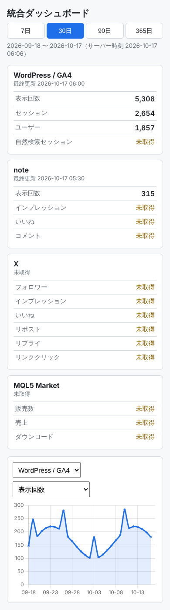

# Portfolio

[日本語](README.md) | **English**

A collection of work by Hamao ("Monogusa Papan").
Working side by side with AI (Claude Code), I research automated trading, build websites and WordPress plugins, make dashboards that gather my results in one place, and write articles.

| Area | Work | Main technologies |
|---|---|---|
| Automated trading (MT5) | Expert Advisors for gold (XAUUSD) and a validation process that guards against overfitting | MQL5, Python (pandas), ONNX, Claude Code |
| MQL5 products and freelance | Two products on MQL5 Market, a signal, EA modifications, merging and monitoring tools | MQL5, MetaEditor, Strategy Tester |
| Website | "Crane-Info", a mobile crane information site, and "Crane Finder", a contractor search plugin | WordPress, PHP, JavaScript, Leaflet |
| Business app | "Media & EA Dashboard", which shows my note / X / WordPress / MQL5 Market results on a phone | Python, GA4 Data API, WordPress, PHP, Chart.js, GitHub Actions |
| Writing | Articles on note (explainers and essays on AI and science, development logs, reviews) | Markdown |

---

## 1. Developing and validating MT5 Expert Advisors (gold)

I build Expert Advisors for gold (XAUUSD) that run on MetaTrader 5, and check them with Python backtests.
I care less about numbers that look profitable and more about whether those numbers are real.

### How I validate
- Parameters are chosen on the in-sample period. The out-of-sample period is looked at only once, after the candidate is fixed
- Results are compared with fake data made by shuffling bars, to confirm the edge comes from the market and not from chance
- Results are split by nearby parameters, by year, and by buys versus sells, to see whether they hold up
- Spread and slippage are included as costs, and MT5 real-tick tests are checked against the Python results

### Main topics
| Topic | What it does | What I found |
|---|---|---|
| Dow theory × multiple Bollinger Bands ("BB stack pullback") | Buys a shallow pullback only when the ZigZag Dow structure and the order of BB20/100/200 line up | MT5 real ticks: in-sample PF 1.77, out-of-sample PF 2.30. Sells had no edge, so buy-only is the default |
| Variable Dow theory | Starts from H4 and, when a timeframe has no clear trend, steps down one timeframe to decide | Stepping down to H1 worked best (PF 1.52 over the last 3 years). Going down to M15 or lower lost to the spread |
| M15 swing × H1 Dow | Added 22 filters one at a time to an M15 Dow theory entry and compared them | "H1 Dow points the same way" was the most stable filter, raising PF for 2015-22 from 0.99 to 1.24 |
| GoldAIFunda | Combines a technical model (ONNX) with a decision file that Claude writes after reading the economic calendar | The EA and Claude talk through files. Includes a demo-only guard, a daily loss limit and a maximum number of positions |
| EA self-improvement loop | A playbook (CLAUDE.md) in which Claude Code repeats "backtest → hypothesis → change one thing" | Rules such as never tuning on the validation period and rejecting results with fewer than 100 trades prevent overfitting |
| MACD scalping | Direction from H1/H4 MACD, trades on M1/M5 | All 216 M1 variants lost money, so it was not turned into an EA. Found and fixed a bug that peeked one higher-timeframe bar ahead |
| One-month money target simulation | Estimated on past data how money management changes the chance of hitting a target versus blowing up | The all-in, compounding plan hit the target 10% of the time and blew up 35% of the time, putting the risk in numbers |

> Source code and trading parameters are not public. All numbers are backtest results on past data. They do not promise future results and are not investment advice.

---

## 2. MQL5 products and the work I can take on

### Products on MQL5 Market
| Product | Description |
|---|---|
| [Gold Variable Dow](https://www.mql5.com/en/market/product/201856) | Variable Dow theory EA for gold. Starts from H4 and steps down one timeframe whenever the trend is unclear |
| [Gold Weekly Lines](https://www.mql5.com/en/market/product/205106) | Gold EA that trades off key weekly levels such as the weekly high and low |

I also run an MQL5 signal, "Gold Daily One", based on a daily-timeframe EA.

### What I have built (selection)
| Type | Description |
|---|---|
| Trading EAs | More than 30 gold EAs: one trade a day on D1, Dow theory × Bollinger Bands, weekly levels, line breaks and more |
| Merging EAs | Merged 7 strategies into one EA, with a separate magic number and ON/OFF switch per strategy. Also fixed a magic number collision between two strategies |
| SL manager | A utility that sets and trails the SL of manually opened positions by ATR or by swing highs and lows. Never moves the SL backward, uses a minimum step, and sends nothing while the market is closed |
| Monitoring tool | An EA that never trades: it only judges the market state and sends a phone notification |
| External file integration | EAs that read CSV files written by Python or an AI (trade scenarios, economic events) from the shared folder and trade on them |
| Chart drawing | Added indicator and line drawing to an existing EA without changing its trading logic |
| Script | A script that exports every deal in the account to CSV, with magic number, profit, swap and commission |

### Examples of bug fixes and safety features
- Found that orders sent while the market was closed failed and were never retried, leaving exits to the stop loss. Fixed it by adding retries
- Risk limit as a percentage of balance per trade; skipping and logging the trade when even the minimum lot exceeds the limit; a cap on concurrent positions across the account; a daily loss limit
- A demo-only guard turned on by default so the EA cannot run on a real account by mistake

### Testing tools
- Built a system that runs the MT5 Strategy Tester in batches from Python, and evaluated 85 EAs under the same conditions
- Python simulations always include swap, as well as spread and round-trip costs

### Work I can take on
- Fixing and extending existing EAs and indicators (filters, alerts, notifications, trailing stops, break-even, on-chart panels)
- New indicators and EAs with clearly defined rules
- Converting MQL4 code to MQL5
- Checking behaviour in the Strategy Tester and reporting backtest results

> Source code for the trading logic is not public. All numbers are backtest results on past data. They do not promise future results and are not investment advice.

---

## 3. Crane-Info and Crane Finder (WordPress)

**Crane-Info** (https://cranecrane.com/) is an information site about mobile cranes (in Japanese).
It explains manufacturers and models, licences and qualifications, wire rope and visual inspections, side loads on slopes, lightning and radio, how to read load charts and more, in words a beginner can follow.

**Crane Finder** is a WordPress plugin I built for this site.
- Find nearby crane contractors and the models they own on a map and in a list (shortcode `[crane_finder]`)
- The map uses GSI tiles from the Geospatial Information Authority of Japan with Leaflet, and place search uses the GSI address search API
- The visitor's location is only used on the device to calculate distances and is never sent to the server
- Contractors can switch their availability from an update link that needs no login, and the status changes to "please contact" automatically after 48 hours
- For the next version, I am designing a listing method that keeps only the information a contractor chooses to publish, keeping personal data to a minimum

---

## 4. Media & EA Dashboard

A dashboard that gathers my results from note, X, WordPress (GA4) and MQL5 Market in one place, so I can check them on my phone every morning.
I built it to stop going round several admin screens.



*The screen shows sample data.*

### How it works
```
GitHub Actions (every morning 6:30) ──▶ Python ──▶ GA4 Data API
                                          │
                                          └─ REST API ──▶ WordPress plugin ──▶ DB / phone screen
```

- **Fetching (Python)**: gets daily views, sessions and users from the GA4 Data API and registers them through the WordPress REST API
- **Scheduling (GitHub Actions)**: the rental server's Python was too old for the GA4 library, so fetching moved to GitHub Actions and runs automatically every morning
- **Storage and display (WordPress plugin)**: stores daily results in a custom table and shows them as cards and charts (Chart.js) on a page with a shortcode. It can be added to the home screen and opened like an app (PWA)
- **Periods**: switch between 7 / 30 / 90 / 365 days. Days with no data are shown as "not fetched", not as 0

### Details I took care of
- Keys and passwords are kept out of the repository and managed in GitHub Secrets. The REST API cannot be used without an administrator's application password
- Registering the same day and metric again overwrites instead of duplicating, so a fetch can be retried safely
- When the server's foreign-access restriction rejected a registration, the error details are now shown so the cause is clear at once
- Simple tests in PHP and JavaScript that run without WordPress

> Real traffic numbers, site admin information and credentials are not public. The source code is kept in a private repository.

---

## 5. Articles on note

As "Monogusa Papan", I write about AI and the latest science and technology from the point of view of a lazy dad, in plain words (articles are in Japanese).

- **I built a forex EA together with AI**: a development log of the EA work above, focused on how to split the work with AI and why it matters to doubt results
- **Is AI building the Tower of Babel?**: an essay on the rapid progress of AI, using the myth as a guide
- **Trying the Xiaomi REDMI Watch 6 Active**: a review of sleep tracking and alarms
- Other articles on AI safety, the co-evolution of humans and AI, quantum and classical mechanics, and industrial strategy explained through Gundam
