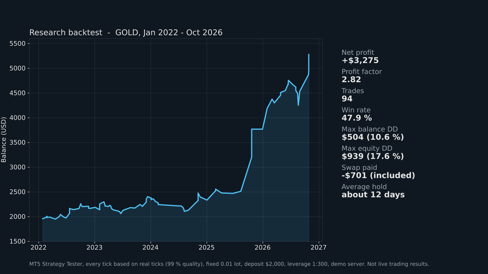
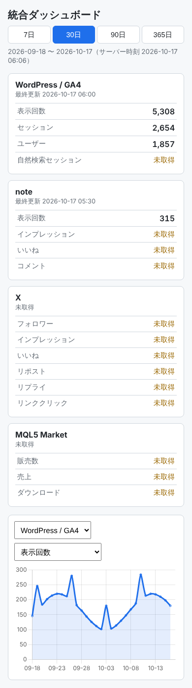

# Portfolio

はまお（ものぐさパパん）の成果物まとめです。
AI（Claude Code）と二人三脚で、自動売買の研究、Webサイトとプラグインの開発、実績を集めるダッシュボードづくり、記事の執筆をしています。

| 分野 | 成果物 | 主な技術 |
|---|---|---|
| 自動売買（MT5） | GOLD向けEAの開発と、過剰最適化を避ける検証の仕組み（約20テーマ、EA 100本の総点検） | MQL5, Python (pandas, numba), ONNX, Claude Code |
| Webサイト | クレーン情報サイト「Crane-Info」と、業者検索プラグイン「Crane Finder」 | WordPress, PHP, JavaScript, Leaflet |
| 業務アプリ | note / X / WordPress / MQL5 Market の実績をスマホで見る「統合ダッシュボード」 | Python, GA4 Data API, WordPress, PHP, Chart.js, GitHub Actions |
| 執筆 | note の記事（AI・科学技術の解説と考察、開発記録、レビュー） | Markdown |

---

## 1. MT5 自動売買 EA の開発と検証（GOLD）

金（XAUUSD）を対象に、MetaTrader 5 で動く EA を作り、Python でバックテストして確かめています。
「勝てそうな数字」よりも「その数字が本物か」を疑うことを重視しています。
2026年10月だけで約20テーマを検証し、自作EA 15本と過去に作ったEA 85本をすべて同じ物差しで評価し直しました。

### 検証の進め方
- 学習期間（IS）でパラメータを決め、検証期間（OOS）は候補を決めた後に1回だけ見る
- 足をシャッフルした偽データ、ずらした偽ライン、ランダムな売買方向と比べて、効いているのが相場の性質かどうかを確かめる
- パラメータの近傍、年別、買い・売り別に分けて、成績が崩れないかを見る
- 一番重く見るのは「金の大相場が始まる前（2015〜2022年）でも勝っていたか」。利益が2025〜26年に偏るのはどの手法にも共通なので、古い相場で崩れないものほど本番向きと判断する
- スプレッドとスリッページをコストとして入れる。上位足の値は確定済みのものだけ使い、先読みを防ぐ。MT5 の実ティックテストと Python の結果が一致するかも確認する

### 本番候補に残った手法
| テーマ | 内容 | 分かったこと |
|---|---|---|
| 週次ライン（GoldWeeklyLines） | 前週・前月・週足・日足などの高値安値が重なる価格を「強いライン」として毎週自動で引き、その抜けを週の予想方向に取る | 強いラインの抜けは、ずらした偽ラインやランダム方向を全回上回った。2015〜26年で PF 1.67、2015〜22年でも 1.38。MQL5 Market 向けの版と紹介画像も用意した |
| 揃った一番上の足で決済（GoldStackExit） | 5分足のダウで入り、15分〜日足のどこまで向きが揃っているかを見て、揃っている一番上の足で手じまいを判断する | 全期間 PF 2.30、2015〜22年 1.58。13年中10年プラスで、設定を変えても崩れにくい |
| 日足・4H一致 → 1H押し目（GoldAlignPullback） | 日足と4時間足の向きが揃ったときだけ、1時間足の押し目を5分足で拾う。根拠が崩れたら決済 | PF 1.57、2015〜22年 1.46。13年中12年プラスで最大DDが最小。一番安定していた |
| 1日1トレード（GoldDailyOne） | 日足の向きと米10年債の動きで「今日の向き」を決め、前日高値（安値）に触れたら1回だけ入る | 全期間 PF 2.07、2015〜22年 1.40。ランダム方向100回の最大より上 |
| ダウ理論 × 複数BB「BBスタック押し目」 | ZigZag のダウ構造と複数のボリンジャーバンドの並びがそろったときだけ浅い押し目で買う | MT5 実ティックで IS PF 1.77、OOS PF 2.30。売りには優位性がなく、買いのみを既定にした |



*GoldWeeklyLines の MT5 ストラテジーテスター結果（実ティック、0.01ロット固定、デモ環境）。実取引の成績ではありません。*

### 検証して「やらない」と決めたこと
| テーマ | 試した規模 | 分かったこと |
|---|---|---|
| スキャルピング総当たり | 31手法 × 約7万通り | 1回約$0.65のコストでは、保有1時間以内で勝てる手法は見つからなかった |
| 全時間足 × ダウ × BB × スイングライン | 1,063通り | 1分〜15分足はどの組み合わせでも負け。効き始めるのは4時間足・日足から |
| 各時間足の方向予測（ロジスティック回帰） | 6時間足 × 11指標 | 未学習期間の的中率は50〜52%で、ほぼコイン投げ。単独の予測は根拠にしない |
| 指標発表前後の回避フィルター | 雇用統計・CPI・FOMC | 発表後の新規を止めるとむしろ悪化。指標で抜けた後の流れは本物のトレンドになりやすい |
| ナンピン・マーチンゲール | 約1,300通り | 5万円口座では1年以内に75〜98%の確率で口座が飛ぶ。利益の源は手法ではなく金の上昇だった |
| 節目の割れ／反発判定 | 345回 | 判定ありで PF 1.09 → 1.92 と大きく改善したが、2015〜22年はトントン。「RSI が売られすぎなら反発しやすい」は逆だった |
| MACD スキャルピング | 216通り | 1分足は全通り赤字。上位足を1本先読みするバグを見つけて直した |

### 仕組みづくり
- **EA の総点検**：過去に作ったEA 85本を MT5 テスターで同じ条件にそろえて回し直し、A（本番候補）・B（条件付き）・C（不採用）の3段階に分けた。ロット計算に誤りがあるEAが38本見つかり、元ファイルは変えずにテスト用コピーで直して評価した
- **EA 自動改善ループ**：Claude Code が「バックテスト → 原因の仮説 → 1か所だけ修正」を繰り返す手順書（CLAUDE.md）。検証期間を見て直さない、取引数100回未満は採用しないなどのルールで、過剰最適化を防ぐ
- **GoldAIFunda**：テクニカル判断（ONNX モデル）に、Claude が経済指標の予定を読んで書く判断ファイルを組み合わせる実験。デモ口座専用のガード、1日の損失上限、最大保有数の安全装置つき

> ソースコードと売買パラメータは公開していません。数字はすべて過去データのバックテスト結果（0.01ロット、コスト込み）で、将来の成果や投資を勧めるものではありません。

---

## 2. Crane-Info と Crane Finder（WordPress）

**Crane-Info**（https://cranecrane.com/）は、移動式クレーンの情報サイトです。
メーカーや機種の特徴、資格・免許、ワイヤーロープや外観の点検、斜面での横荷重、雷と無線、性能表の読み方などを、初めての人にも分かる言葉で書いています。

**Crane Finder** は、このサイト用に作った WordPress プラグインです。
- 近くのクレーン業者と保有機種を、地図と一覧で探せる（ショートコード `[crane_finder]`）
- 地図は国土地理院の地理院タイルと Leaflet、地名検索は地理院の住所検索 API を使う
- 現在地は端末の中で距離計算に使うだけで、サーバーには送らない
- 業者はログイン不要の更新用リンクから空き状況を切り替えられ、48時間たつと自動で「要問い合わせ」表示になる
- 次の版では、業者が「載せる」と選んだ情報だけを持つ、個人情報を最小限にした掲載方法を設計中

---

## 3. 統合ダッシュボード（Media & EA Dashboard）

note、X、WordPress（GA4）、MQL5 Market の実績を一か所に集めて、スマートフォンから毎朝見られるようにしたダッシュボードです。
あちこちの管理画面を開いて回る手間をなくすために作りました。



*画面はサンプルデータで表示したものです。*

### しくみ
```
GitHub Actions（毎朝 6:30）──▶ Python ──▶ GA4 Data API
                                  │
                                  └─ REST API ──▶ WordPress プラグイン ──▶ DB / スマホ画面
```

- **取得（Python）**：GA4 Data API から表示回数・セッション・ユーザー数を日別に取得し、WordPress の REST API に登録する
- **定期実行（GitHub Actions）**：レンタルサーバーの Python が古く GA4 のライブラリが動かなかったため、取得を GitHub Actions に移して毎朝自動で動かす
- **保存と表示（WordPress プラグイン）**：独自テーブルに日別の実績を保存し、ショートコードを置いたページにカードとグラフ（Chart.js）で表示する。ホーム画面に追加してアプリのように開ける（PWA）
- **集計期間**：7 / 30 / 90 / 365 日を切り替えられる。取れていない日は 0 ではなく「未取得」と区別して表示する

### 工夫したところ
- 鍵とパスワードはリポジトリに入れず、GitHub の Secrets で管理する。REST API は管理者のアプリケーションパスワードがないと使えない
- 同じ日・同じ指標を再登録しても二重にならず上書きされるので、取得を何度やり直しても安全
- サーバーの国外アクセス制限で登録が拒否されたとき、原因がすぐ分かるようにエラー内容を表示するよう改善した
- WordPress なしで動く簡易テストを PHP と JavaScript で用意した

> 実際のアクセス数、サイトの管理情報、認証情報は公開していません。ソースコードは非公開リポジトリで管理しています。

---

## 4. note の記事

「ものぐさパパん」として、AI と最新の科学技術を、ものぐさな父親目線でかみ砕いて書いています。

- **AIと二人三脚でFXの自動売買（EA）を作ってみた**：上の EA 開発を、AI との分担の仕方と「結果を疑う」大切さを中心に書いた開発記録
- **AIはバベルの塔を建てているのか**：AI の急速な進化を、神話を手がかりに考える考察記事
- **Xiaomi REDMI Watch 6 Active を使ってみた**：睡眠記録やアラームの使用感のレビュー
- そのほか、AI の安全性、人間と AI の共進化、量子力学と古典力学、ガンダムで読み解く産業戦略などの記事
