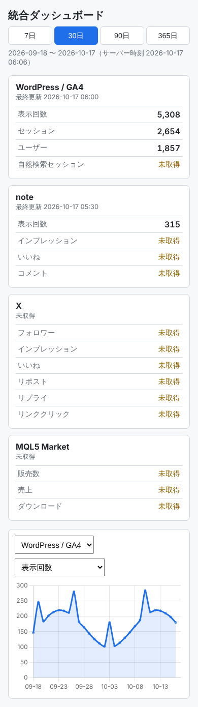

# Portfolio

はまお（ものぐさパパん）の成果物まとめです。
AI（Claude Code）と二人三脚で、自動売買の研究、Webサイトとプラグインの開発、実績を集めるダッシュボードづくり、記事の執筆をしています。

| 分野 | 成果物 | 主な技術 |
|---|---|---|
| 自動売買（MT5） | GOLD向けEAの開発と、過剰最適化を避ける検証の仕組み | MQL5, Python (pandas), ONNX, Claude Code |
| MQL5 公開・受託 | MQL5 Market への出品2本、シグナル配信、EA の改修・統合・監視ツール | MQL5, MetaEditor, Strategy Tester |
| Webサイト | クレーン情報サイト「Crane-Info」と、業者検索プラグイン「Crane Finder」 | WordPress, PHP, JavaScript, Leaflet |
| 業務アプリ | note / X / WordPress / MQL5 Market の実績をスマホで見る「統合ダッシュボード」 | Python, GA4 Data API, WordPress, PHP, Chart.js, GitHub Actions |
| 執筆 | note の記事（AI・科学技術の解説と考察、開発記録、レビュー） | Markdown |

---

## 1. MT5 自動売買 EA の開発と検証（GOLD）

金（XAUUSD）を対象に、MetaTrader 5 で動く EA を作り、Python でバックテストして確かめています。
「勝てそうな数字」よりも「その数字が本物か」を疑うことを重視しています。

### 検証の進め方
- 学習期間（IS）でパラメータを決め、検証期間（OOS）は候補を決めた後に1回だけ見る
- 足をシャッフルした偽データと比べて、効いているのが相場の性質かどうかを確かめる
- パラメータの近傍、年別、買い・売り別に分けて、成績が崩れないかを見る
- スプレッドとスリッページをコストとして入れる。MT5 の実ティックテストと Python の結果が一致するかも確認する

### 主なテーマ
| テーマ | 内容 | 分かったこと |
|---|---|---|
| ダウ理論 × 複数BB「BBスタック押し目」 | ZigZag のダウ構造と BB20/100/200 の並びがそろったときだけ浅い押し目で買う | MT5 実ティックで IS PF 1.77、OOS PF 2.30。売りには優位性がなく、買いのみを既定にした |
| 可変ダウ理論 | H4 から順に、トレンドがはっきりしない足では1つ下の足へ降りて判断する | H1 まで降りる版が最良（直近3年 PF 1.52）。M15 以下まで降りるとスプレッドに負ける |
| M15 スイング × H1 ダウ | M15 のダウ理論に22種類のフィルターを1つずつ足して比較 | 「H1 のダウも同じ方向」が最も安定して効き、2015〜22年の PF が 0.99 から 1.24 に上がった |
| GoldAIFunda | テクニカル判断（ONNX モデル）に、Claude が経済指標の予定を読んで書く判断ファイルを組み合わせる | EA と Claude はファイルでやり取りする。デモ口座専用のガード、1日の損失上限、最大保有数の安全装置つき |
| EA 自動改善ループ | Claude Code が「バックテスト → 原因の仮説 → 1か所だけ修正」を繰り返す手順書（CLAUDE.md）を作った | 検証期間を見て直さない、取引数100回未満は採用しないなどのルールで、過剰最適化を防ぐ |
| MACD スキャルピング | H1/H4 の MACD で方向を決め、M1/M5 で売買 | M1 は全216通りが赤字で、EA化はしないと判断。上位足を1本先読みするバグを見つけて直した |
| 1か月の資金目標シミュレーション | 資金管理の違いで、目標達成率と破綻率がどう変わるかを過去データで試算 | 全力と積み増しで攻める案は、目標達成10%に対して破綻35%。リスクの大きさを数字で示した |

> ソースコードと売買パラメータは公開していません。数字はすべて過去データのバックテスト結果で、将来の成果や投資を勧めるものではありません。

---

## 2. MQL5 での公開実績と、お受けできる作業

### MQL5 Market に出品中の EA
| 製品 | 内容 |
|---|---|
| [Gold Variable Dow](https://www.mql5.com/en/market/product/201856) | 可変ダウ理論。H4 から順に見て、トレンドがはっきりしない足では1つ下の足へ降りて判断する GOLD 用 EA |
| [Gold Weekly Lines](https://www.mql5.com/en/market/product/205106) | 週足の高値・安値などの節目ラインを使って売買する GOLD 用 EA |

このほか、日足ベースの EA「Gold Daily One」で MQL5 シグナルを配信しています。

### 作ってきたもの（抜粋）
| 種類 | 内容 |
|---|---|
| 売買 EA | 日足1日1回の売買、ダウ理論 × ボリンジャーバンド、週足ライン、ライン抜けなど、GOLD 用の EA を30本以上 |
| 複数 EA の統合 | 7つの戦略を1本の EA にまとめ、戦略ごとにマジックナンバーと ON/OFF を分けた。重複していたマジックナンバーの衝突も直した |
| SL 管理ツール | 手動で建てたポジションに、ATR やスイングの安値・高値で SL を付けて追従させるユーティリティ。SL は戻さない、最小移動幅、市場が閉じている間は送らない |
| 監視ツール | 売買はせず、相場の状態を判定してスマホに通知するだけの EA |
| 外部ファイル連携 | Python や AI が書いた CSV（売買シナリオ、指標予定など）を共通フォルダから読んで売買する EA |
| 表示の追加 | 売買ロジックは変えずに、インジケーターやラインをチャートに描く機能を既存 EA に追加 |
| スクリプト | 口座の全約定をマジックナンバー・損益・スワップ・手数料つきで CSV に書き出すスクリプト |

### 不具合修正と安全装置の例
- 市場が閉まっている時刻に出した注文が失敗したまま再送されず、決済が SL 任せになっていた不具合を見つけ、再試行を入れて直した
- 1回の損失を残高の何％までにするリスク上限、最小ロットでも上限を超えるときは見送ってログに残す処理、口座全体の同時保有数の上限、1日の損失上限
- 実口座で誤って動かないよう、デモ専用のガードを既定で ON にする

### 検証の道具
- MT5 のストラテジーテスターを Python から一括で動かす仕組みを作り、85本の EA を同じ条件でまとめて評価した
- Python のシミュレーションには、スプレッドと往復コストに加えてスワップも必ず入れる

### お受けできる作業
- 既存 EA・インジケーターの修正、機能の追加（フィルター、アラート、通知、トレール、建値移動、パネル表示）
- ルールがはっきりしたインジケーター・EA の新規作成
- MQL4 から MQL5 への移植
- ストラテジーテスターでの動作確認とバックテストの報告

<details>
<summary>English summary</summary>

- Seller on MQL5 Market: [Gold Variable Dow](https://www.mql5.com/en/market/product/201856), [Gold Weekly Lines](https://www.mql5.com/en/market/product/205106). Also running the MQL5 signal "Gold Daily One".
- Built 30+ XAUUSD Expert Advisors, merged 7 strategies into one EA with per-strategy magic numbers, and wrote an SL manager for manual positions (ATR / swing trailing, never moves SL backward, minimum step, no requests while the market is closed).
- Typical fixes: orders rejected at market close are now retried; risk caps per trade, per day and on concurrent positions; demo-only guards on by default.
- Automated Strategy Tester runs from Python to compare many EAs under the same conditions.
- Available for: EA / indicator modifications, new indicators or EAs with a clear spec, MQL4 to MQL5 conversion, Strategy Tester verification.

</details>

> 売買ロジックのソースコードは公開していません。数字はすべて過去データのバックテスト結果で、将来の成果や投資を勧めるものではありません。

---

## 3. Crane-Info と Crane Finder（WordPress）

**Crane-Info**（https://cranecrane.com/）は、移動式クレーンの情報サイトです。
メーカーや機種の特徴、資格・免許、ワイヤーロープや外観の点検、斜面での横荷重、雷と無線、性能表の読み方などを、初めての人にも分かる言葉で書いています。

**Crane Finder** は、このサイト用に作った WordPress プラグインです。
- 近くのクレーン業者と保有機種を、地図と一覧で探せる（ショートコード `[crane_finder]`）
- 地図は国土地理院の地理院タイルと Leaflet、地名検索は地理院の住所検索 API を使う
- 現在地は端末の中で距離計算に使うだけで、サーバーには送らない
- 業者はログイン不要の更新用リンクから空き状況を切り替えられ、48時間たつと自動で「要問い合わせ」表示になる
- 次の版では、業者が「載せる」と選んだ情報だけを持つ、個人情報を最小限にした掲載方法を設計中

---

## 4. 統合ダッシュボード（Media & EA Dashboard）

note、X、WordPress（GA4）、MQL5 Market の実績を一か所に集めて、スマートフォンから毎朝見られるようにしたダッシュボードです。
あちこちの管理画面を開いて回る手間をなくすために作りました。



*画面はサンプルデータで表示したものです。*

### しくみ
```
GitHub Actions（毎朝 6:30）──▶ Python ──▶ GA4 Data API
                                  │
                                  └─ REST API ──▶ WordPress プラグイン ──▶ DB / スマホ画面
```

- **取得（Python）**：GA4 Data API から表示回数・セッション・ユーザー数を日別に取得し、WordPress の REST API に登録する
- **定期実行（GitHub Actions）**：レンタルサーバーの Python が古く GA4 のライブラリが動かなかったため、取得を GitHub Actions に移して毎朝自動で動かす
- **保存と表示（WordPress プラグイン）**：独自テーブルに日別の実績を保存し、ショートコードを置いたページにカードとグラフ（Chart.js）で表示する。ホーム画面に追加してアプリのように開ける（PWA）
- **集計期間**：7 / 30 / 90 / 365 日を切り替えられる。取れていない日は 0 ではなく「未取得」と区別して表示する

### 工夫したところ
- 鍵とパスワードはリポジトリに入れず、GitHub の Secrets で管理する。REST API は管理者のアプリケーションパスワードがないと使えない
- 同じ日・同じ指標を再登録しても二重にならず上書きされるので、取得を何度やり直しても安全
- サーバーの国外アクセス制限で登録が拒否されたとき、原因がすぐ分かるようにエラー内容を表示するよう改善した
- WordPress なしで動く簡易テストを PHP と JavaScript で用意した

> 実際のアクセス数、サイトの管理情報、認証情報は公開していません。ソースコードは非公開リポジトリで管理しています。

---

## 5. note の記事

「ものぐさパパん」として、AI と最新の科学技術を、ものぐさな父親目線でかみ砕いて書いています。

- **AIと二人三脚でFXの自動売買（EA）を作ってみた**：上の EA 開発を、AI との分担の仕方と「結果を疑う」大切さを中心に書いた開発記録
- **AIはバベルの塔を建てているのか**：AI の急速な進化を、神話を手がかりに考える考察記事
- **Xiaomi REDMI Watch 6 Active を使ってみた**：睡眠記録やアラームの使用感のレビュー
- そのほか、AI の安全性、人間と AI の共進化、量子力学と古典力学、ガンダムで読み解く産業戦略などの記事
